# Диаграми на дипломната

GitHub показва диаграмите по-долу директно. Генерирано от `src/*.mmd` – редактирайте изходните файлове.

## Фигура 1. SWOT анализ на платформата KAIROS

Изходен файл: [`src/01-swot.mmd`](src/01-swot.mmd) · [PNG](out/01-swot.png) · [SVG](out/01-swot.svg) · [HTML](out/01-swot.html)

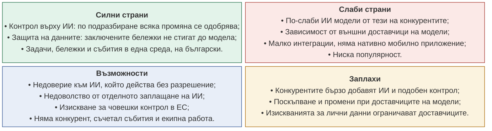

## Фигура 2. Use Case диаграма на системата KAIROS

Изходен файл: [`src/02-use-case.mmd`](src/02-use-case.mmd) · [PNG](out/02-use-case.png) · [SVG](out/02-use-case.svg) · [HTML](out/02-use-case.html)

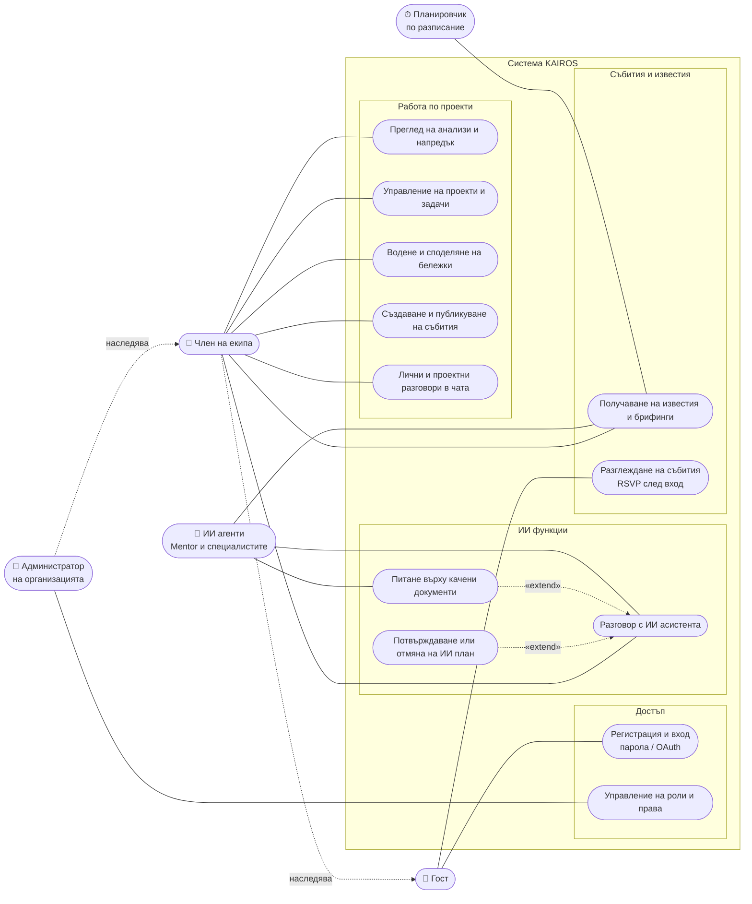

## Фигура 3. Site Map на платформата KAIROS

Изходен файл: [`src/03-site-map.mmd`](src/03-site-map.mmd) · [PNG](out/03-site-map.png) · [SVG](out/03-site-map.svg) · [HTML](out/03-site-map.html)

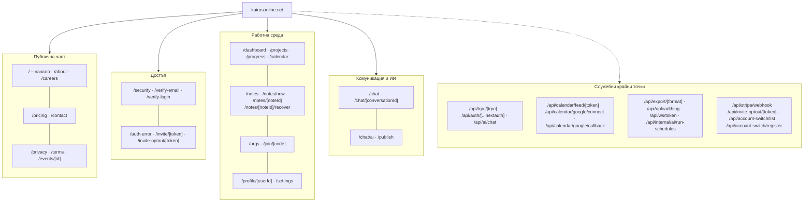

## Фигура 4. Многослойна архитектура на платформата KAIROS

Изходен файл: [`src/04-architecture.mmd`](src/04-architecture.mmd) · [PNG](out/04-architecture.png) · [SVG](out/04-architecture.svg) · [HTML](out/04-architecture.html)

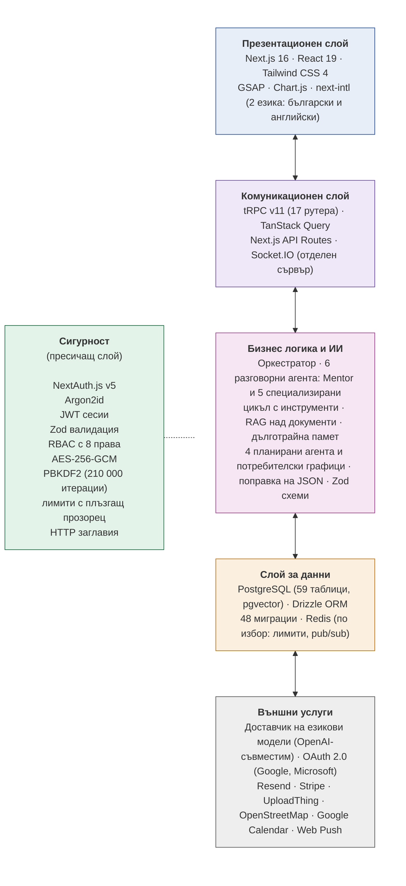

## Фигура 5. Домейни в релационния модел на данните

Изходен файл: [`src/05-data-domains.mmd`](src/05-data-domains.mmd) · [PNG](out/05-data-domains.png) · [SVG](out/05-data-domains.svg) · [HTML](out/05-data-domains.html)

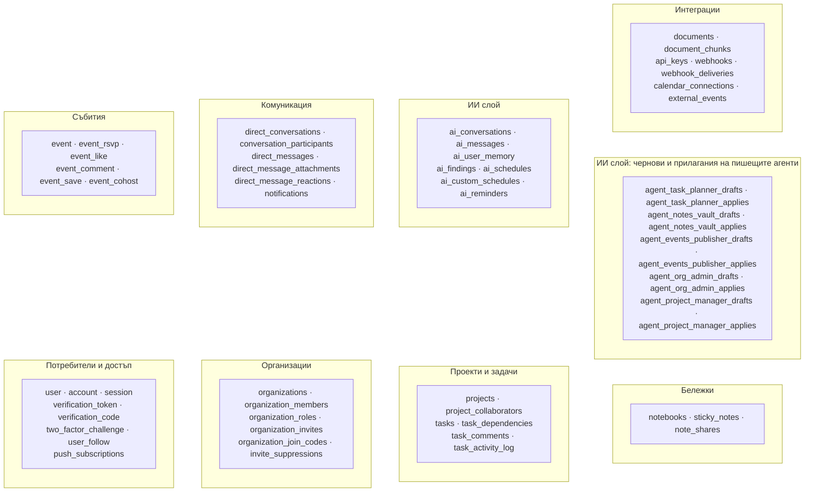

## Фигура 6. Архитектура на многоагентната система на KAIROS

Изходен файл: [`src/06-agent-architecture.mmd`](src/06-agent-architecture.mmd) · [PNG](out/06-agent-architecture.png) · [SVG](out/06-agent-architecture.svg) · [HTML](out/06-agent-architecture.html)

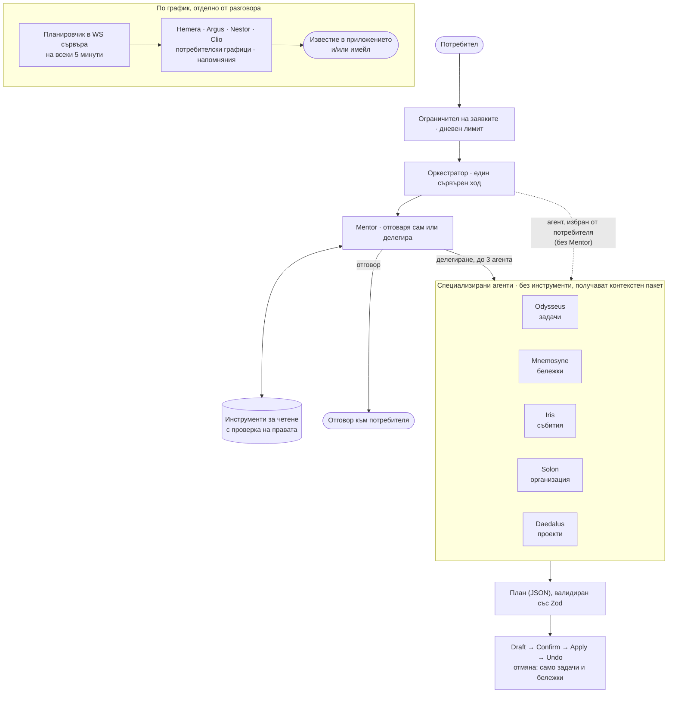

## Фигура 7, 19. Последователност на един ход на многоагентната система

Изходен файл: [`src/07-agent-turn.mmd`](src/07-agent-turn.mmd) · [PNG](out/07-agent-turn.png) · [SVG](out/07-agent-turn.svg) · [HTML](out/07-agent-turn.html)

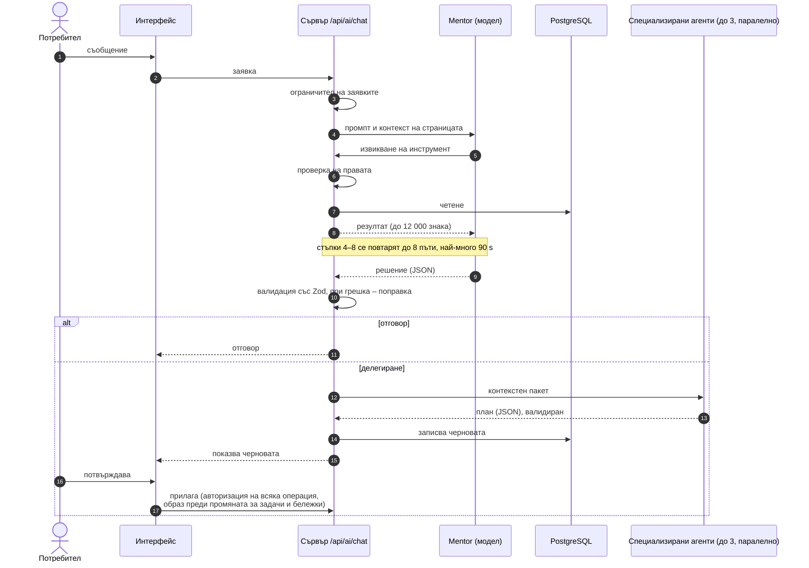

## Фигура 8, 18. Жизнен цикъл на плана на пишещ агент: чернова, потвърждение, прилагане и отмяна

Изходен файл: [`src/08-plan-lifecycle.mmd`](src/08-plan-lifecycle.mmd) · [PNG](out/08-plan-lifecycle.png) · [SVG](out/08-plan-lifecycle.svg) · [HTML](out/08-plan-lifecycle.html)

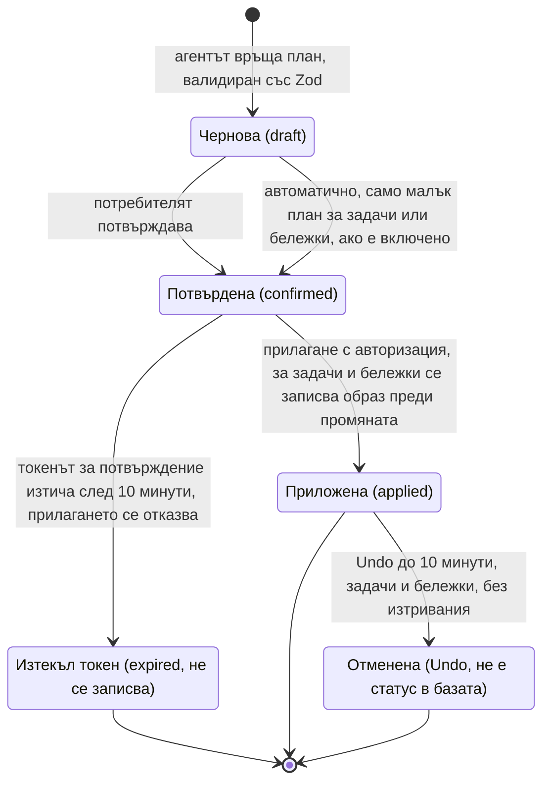

## Фигура 9. Конвейер за извличане с обогатяване над качени документи

Изходен файл: [`src/09-rag.mmd`](src/09-rag.mmd) · [PNG](out/09-rag.png) · [SVG](out/09-rag.svg) · [HTML](out/09-rag.html)

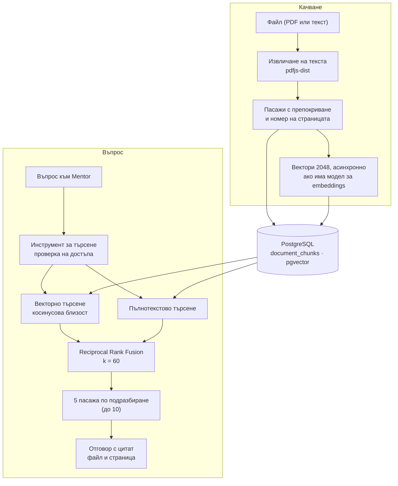

## Фигура 10. Поток на планираните агенти: детерминистично откриване и формулировка от модела

Изходен файл: [`src/10-scheduled-agents.mmd`](src/10-scheduled-agents.mmd) · [PNG](out/10-scheduled-agents.png) · [SVG](out/10-scheduled-agents.svg) · [HTML](out/10-scheduled-agents.html)

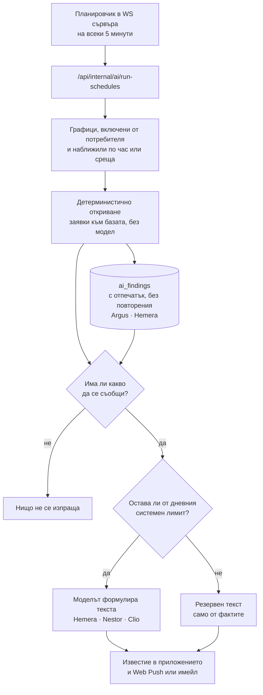

## Фигура 11. Функционално взаимодействие между ролите в платформата KAIROS

Изходен файл: [`src/11-roles.mmd`](src/11-roles.mmd) · [PNG](out/11-roles.png) · [SVG](out/11-roles.svg) · [HTML](out/11-roles.html)

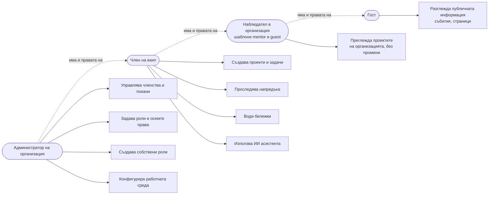

## Фигура 12. Архитектура на известията извън приложението

Изходен файл: [`src/12-push-architecture.mmd`](src/12-push-architecture.mmd) · [PNG](out/12-push-architecture.png) · [SVG](out/12-push-architecture.svg) · [HTML](out/12-push-architecture.html)

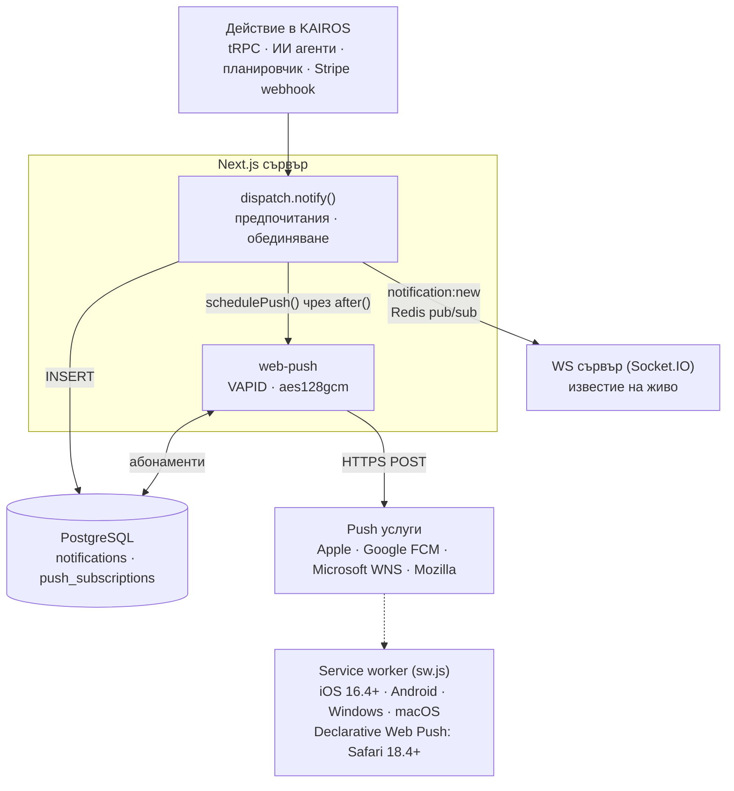

## Фигура 13. UML диаграма на абониране на устройство

Изходен файл: [`src/13-push-subscribe.mmd`](src/13-push-subscribe.mmd) · [PNG](out/13-push-subscribe.png) · [SVG](out/13-push-subscribe.svg) · [HTML](out/13-push-subscribe.html)

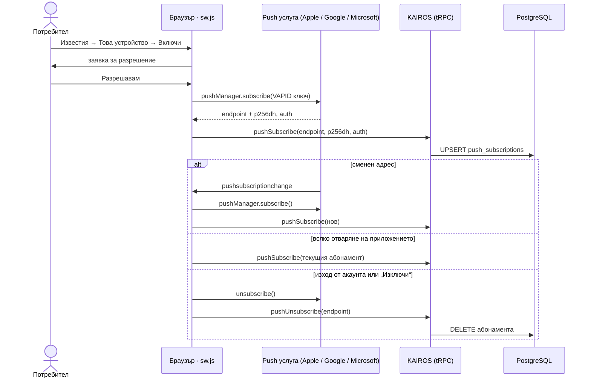

## Фигура 14. Последователност на двуфакторния вход с код или одобрение през линк

Изходен файл: [`src/14-two-factor-sequence.mmd`](src/14-two-factor-sequence.mmd) · [PNG](out/14-two-factor-sequence.png) · [SVG](out/14-two-factor-sequence.svg) · [HTML](out/14-two-factor-sequence.html)

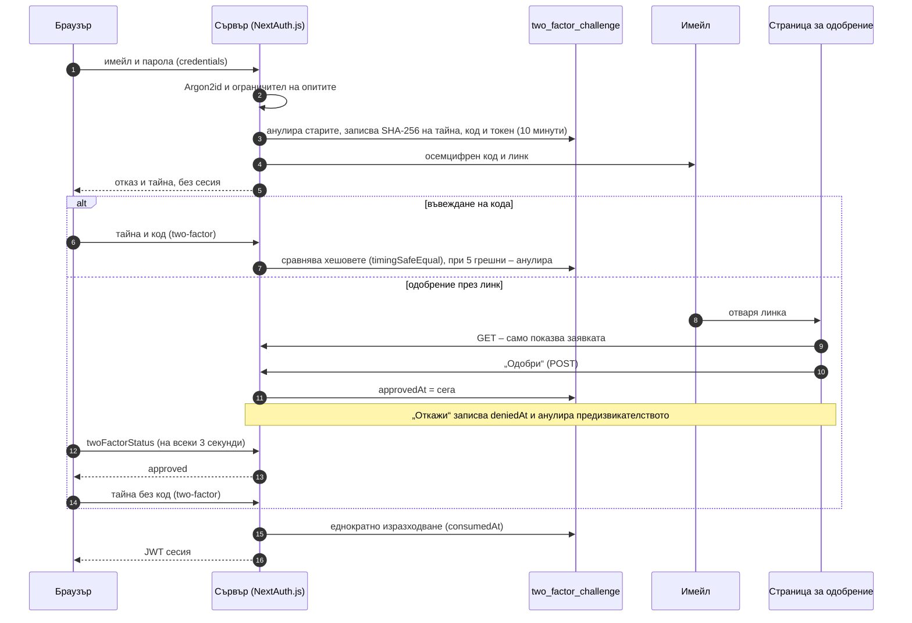

## Фигура 15. Състояния на предизвикателството за двуфакторен вход

Изходен файл: [`src/15-two-factor-states.mmd`](src/15-two-factor-states.mmd) · [PNG](out/15-two-factor-states.png) · [SVG](out/15-two-factor-states.svg) · [HTML](out/15-two-factor-states.html)

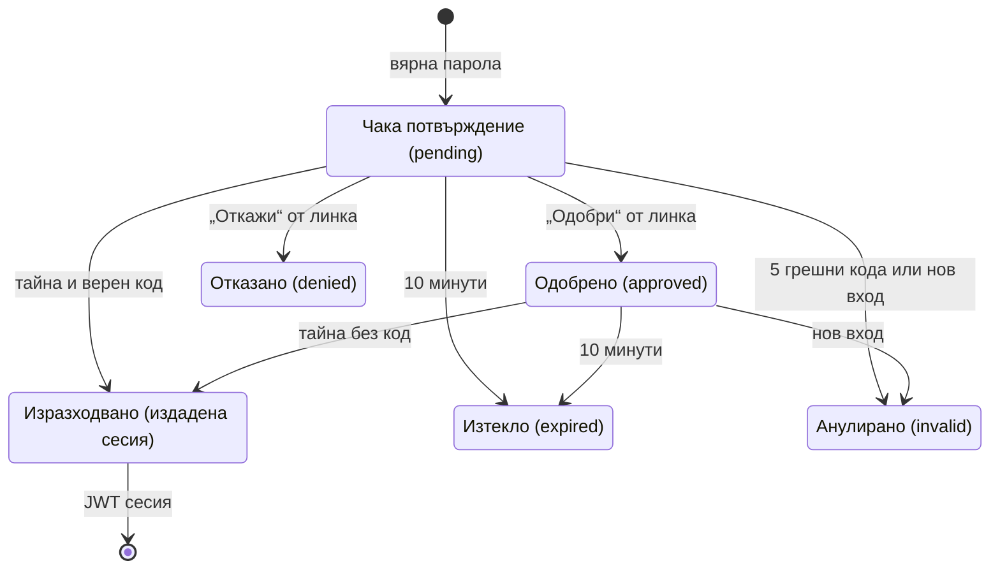

## Фигура 16. Заключване и отключване на бележка с парола

Изходен файл: [`src/16-note-lock.mmd`](src/16-note-lock.mmd) · [PNG](out/16-note-lock.png) · [SVG](out/16-note-lock.svg) · [HTML](out/16-note-lock.html)

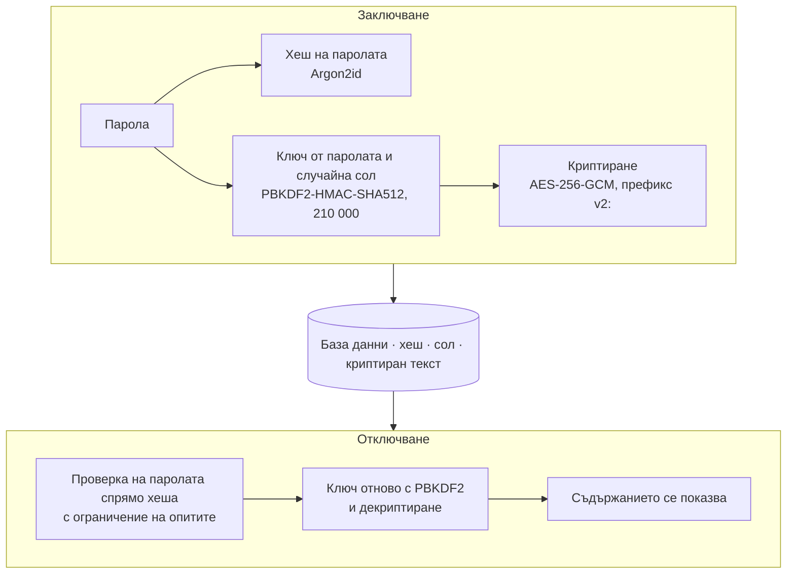

## Фигура 17. Релационен модел (ER диаграма) на базата данни на KAIROS

Изходен файл: [`src/17-er.mmd`](src/17-er.mmd) · [PNG](out/17-er.png) · [SVG](out/17-er.svg) · [HTML](out/17-er.html)

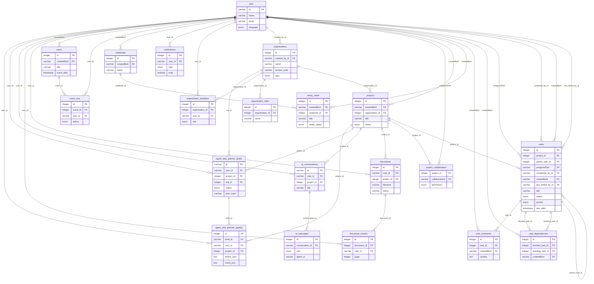

## Фигура 20. Резултати от оценката на маршрутизацията

Изходен файл: [`src/20-routing-results.mmd`](src/20-routing-results.mmd) · [PNG](out/20-routing-results.png) · [SVG](out/20-routing-results.svg) · [HTML](out/20-routing-results.html)

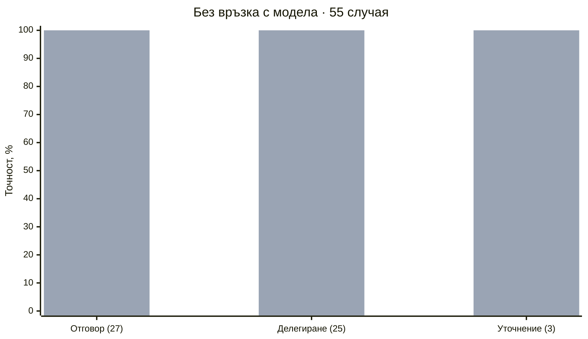

## Фигура 21. Сравнение на резултатите без връзка и с реален модел

Изходен файл: [`src/21-offline-vs-model.mmd`](src/21-offline-vs-model.mmd) · [PNG](out/21-offline-vs-model.png) · [SVG](out/21-offline-vs-model.svg) · [HTML](out/21-offline-vs-model.html)

```mermaid
---
config:
  xyChart:
    width: 1000
    height: 540
  themeVariables:
    xyChart:
      plotColorPalette: "#9aa4b4, #2c4f8f"
---
%% Фигура 21 – Без връзка (сиво) спрямо реален модел gpt-oss-20b (синьо), 25.09.2026
xychart-beta
  title "55 случая · сиво: без връзка (100 %) · синьо: gpt-oss-20b"
  x-axis ["Схема, 1-ви отговор", "Схема, след поправка", "Маршрутизация"]
  y-axis "%" 0 --> 100
  bar [100, 100, 100]
  bar [96.4, 98.2, 72.7]
```
